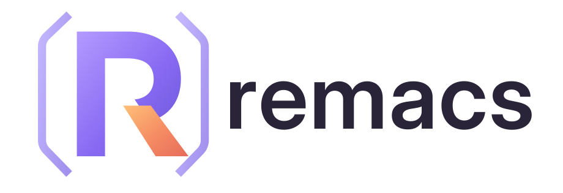

<p align="center">
  <picture>
    <source media="(prefers-color-scheme: dark)" srcset="assets/remacs-wordmark-dark.svg">
    
  </picture>
</p>

<h1 align="center">Remacs</h1>
<p align="center"><strong>A little editor with room to grow.</strong></p>

**Remacs** is a tiny terminal text editor written in Rust, inspired by the
keyboard-first editing experience of [MicroEmacs](https://github.com/mittelmark/microemacs).
No GUI, no menus, no daemon, and no configuration required to start editing.

This is an independent implementation, **not** a port of MicroEmacs' C code.
The first milestone focuses on the essentials; Lua plugins and LSP are future goals.

## Get started

Requires a recent stable Rust toolchain and a terminal on Linux or macOS.

```sh
git clone https://github.com/dme86/Remacs.git
cd Remacs
cargo run -- README.md
# or: cargo install --path . && remacs README.md
```

Open an existing file or pass a new filename to create it on first save.
Start with `remacs` to open an empty unnamed buffer.

## Keyboard shortcuts

| Action | Shortcut |
| --- | --- |
| Save file | **Ctrl+X, Ctrl+S** |
| Open file | **Ctrl+X, Ctrl+F** |
| Quit (confirms unsaved changes) | **Ctrl+X, Ctrl+C** |
| Move | **Arrow keys** or **Ctrl+B/F/P/N** |
| Beginning / end of line | **Ctrl+A / Ctrl+E** |
| Delete at cursor | **Ctrl+D** |
| Kill to end of line | **Ctrl+K** |
| Yank last killed text | **Ctrl+Y** |
| Page down / up | **Ctrl+V / Alt+V** |
| Cancel minibuffer | **Esc** or **Ctrl+G** |

The editor has a file buffer, a status line, a simple minibuffer, UTF-8 text
editing, basic horizontal/vertical scrolling, and CRLF/LF preservation.

## Scope

**Included in v0.1:** opening, editing, and saving text; Emacs-style cursor
movement; kill/yank; a status line and minibuffer; minimal dependency footprint.

**Not yet included:** Lua, LSP, tree view, syntax highlighting, undo, search,
multiple buffers, tabs, splits, mouse support, or menus. This release is not
intended to replace a full-featured editor yet. Some complex Unicode grapheme
clusters and control sequences need more work.

## Development

```sh
cargo fmt --check
cargo test
cargo clippy --all-targets -- -D warnings
```

See [MicroEmacs](https://github.com/mittelmark/microemacs) for the historical
inspiration. Remacs does not import MicroEmacs source code.

MIT license.